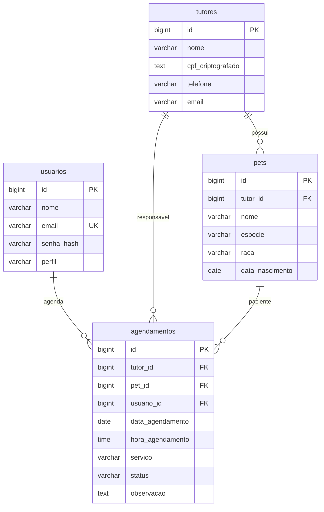

# VetSystem — Sistema de Gestão para Clínica Veterinária (SAEP)

**Avaliação Prática de Desempenho dos Estudantes - SAEP**

**Tecnologias**: PHP 8.5, PostgreSQL, PDO 

**Arquitetura**: MVC Artesanal, Autoload PSR-4 via composer

---

## Apresentação do Projeto e Visão Geral

Este documento apresenta a resolução para o **VetSystem — Sistema de Gestão de Clínica Veterinária**

- Segurança LGPD
- Sessão com Tempo de Expiração
- Código Limpo e Princípio SOLID
- Uso de Credenciais 
- Prevenção Anti Vulnerabiilidade (XSS, SQL Injection, CSRF)

## Entregas

### Identificação do Projeto
- **Nome do Sistema**: VetSystem - Sistema de Gestão de Clinica Veterinária
- **Público-Alvo**: Veterinários, Recepcionista e Gestores da Clínica
- **Problema**: Eliminação dos controles manuais, duplicidade de registro, perda de agendamentos, risco de vazamentos de dados(LGPD)

### Requsitos Funcionais (RF)

- **RF-01**: Autenticação do Usuário com Sessão e Expiração => O sistema deve autenticar o usuário com email e senha(hash de criptografia). Exibir Alerta em CAso de Erro. Sessão deve expirar automaticamento após 15 minutos de intividde
- **RF-02**: Logout => encerramento da sessão , destruindo os dados do usuário (cookies)
- **RF-03**: Painel Principal (DASHBOARD) => tela inicial após o login, deve exibir o nome do usuário logado
- **RF-04**: Cadastro de Tutores (LGPD) => Cadastrar infrmações dos tutores criptografndo dados sensíveis (CPF)
- **RF-05**: Busca e Listagem de Tutores => Campo de pesquisa por termo e listagem dos resultados
- **RF-06**: Edição dos Tutores => Permitir a alteração dos dados dos Tutores
- **RF-07**: Cadastro dos Pets com Vínculo em Tutor => Cadastro de Novo pet associado a um tutor
- **RF-08**: Listagem dos Pets: Exibir a Lista de Pets Cadastrados
- **RF-09**: Agendamento e Listagem de Agendamento => o Sistema deve permitir cadastrar um agendamento e listar ordenadas por data de todos os agendamentos
- **RF-10**: Atualização de Agendamento => permitir alterar informações do agendamento

### Requisitos Não Funcionais (RNF)

- RNF-01: Arquitetura MVC
- RNF-02: Mapeamento via PSR-04
- RNF-03: Proteção e Criptografia
- RNF-04: Armazenamento em Banco de Dados Relacional

## Usuários de demonstração

Os três usuários são carregados com a senha `123456`:

| E-mail | Perfil |
|---|---|
| `camila.vet@vetsystem.com` | Veterinário |
| `lucas.recepcao@vetsystem.com` | Recepcionista |
| `gestao@vetsystem.com` | Administrador |


## Estrutura    

```text
sistema/
├── config/database.ini
├── public/index.php
└── src/
    ├── Controller/
    ├── Models/
    ├── core/
    └── views/
schema.sql
```

## Diagrama entidade-relacionamento


